# 🌳 Explore Chaupal

**Your mouse pointer is a person. The campground is real. There is a village under the big tree that wants to talk to you.**

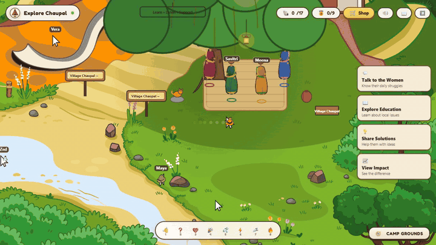

<sub>Straight from the build in this folder — no mockups. [▶ Watch the 11s clip (mp4)](media/gameplay.mp4)</sub>

`Vanilla JS` · `Canvas 2D` · `Rive` · `howler.js` · `zero build step` · `plays offline`

---

## So, what is this?

A handmade, framework-free campground you can wander: twelve illustrated maps, forty-something campers with names and hats, seashells to hoard, a cinema that actually plays films, water you can swim in, and a banyan tree on the east side where four village women sit and tell you what girls' education really costs.

The whole thing is ~8,300 lines of plain JavaScript drawing into two canvases. There is no `npm install`, no bundler, no server-side anything. Open it and walk.

**Three things people say when they see it:**

1. *"Wait, my cursor is walking."* — yes. Pointer lock makes the arrow the avatar.
2. *"The tree is talking."* — yes. In Hinglish.
3. *"Is that a film playing?"* — yes, six of them, on a tilted board, from local files.

---

## Take it for a spin

```powershell
cd Chaupal
node serve.js
# → http://127.0.0.1:8901/
```

No install step. `serve.js` is 113 lines of Node core and also streams the local film library. (Playwright is only for the test scripts.)

| Input | What happens |
|---|---|
| **Move mouse** | Walk. The cursor *is* the scout. |
| **WASD / arrows** | Walk at 360 px/s, in every room |
| **Click** | Doors, levers, shells, chairs, people, the cat, the ball |
| **1 – 8** | Emotes: wave, ponder, love, party, sweat, zap, sleep, groove |
| **Right click** | Quick emote |
| **H** | Camp guide and secrets |
| **M** | Mute |
| **Esc** | Pause |

---

## The tour

### You start at the gate

| The card | The place behind it |
|---|---|
| 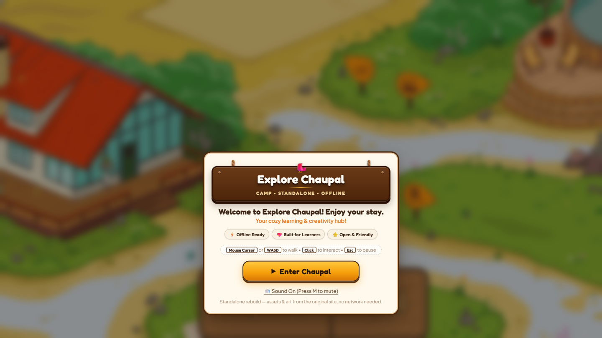 | 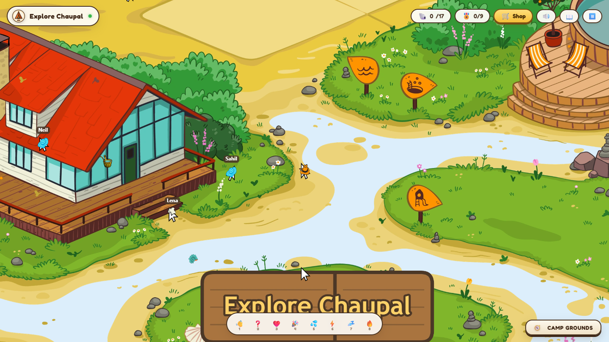 |

The world is already running behind the welcome card — birds, water, campers. Press **Enter Chaupal** and you're in it.

### Follow the signs east

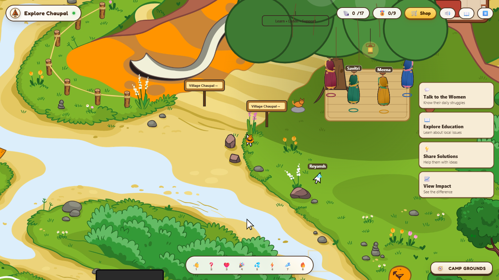

Two hand-painted signs point the way past the clubhouse. The canopy is drawn *above* the player layer, so you genuinely walk in under the leaves.

### Village Chaupal

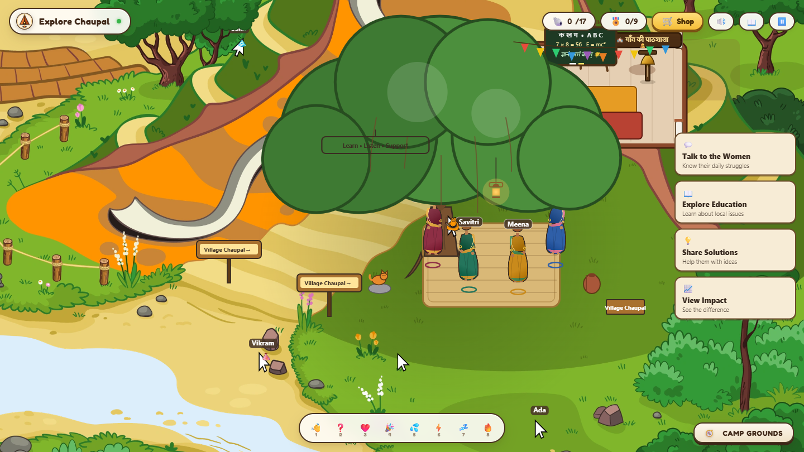

Jute mat, earthen pot, hanging lantern, a "Learn • Listen • Support" plaque, and Mintu the cat on a rock. All of it is painted live on canvas — no new image files were added for the village.

### Four women, four stories

| Pick a woman | Her story types itself out |
|---|---|
| 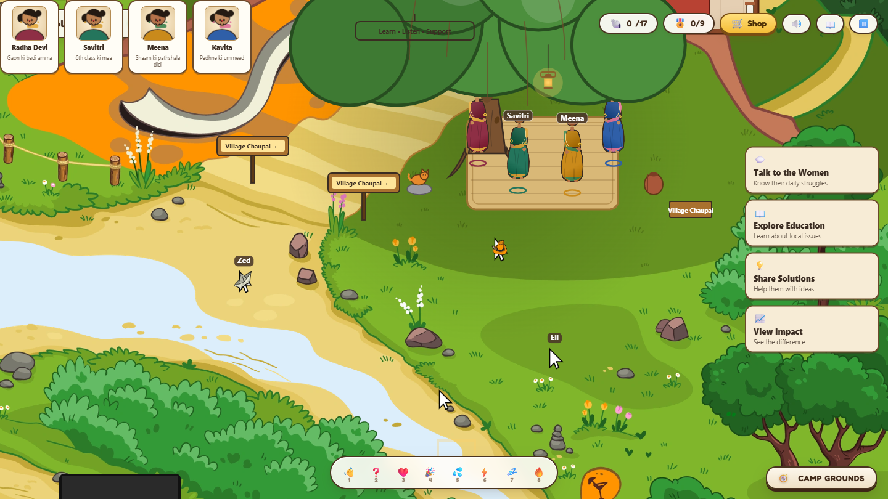 | 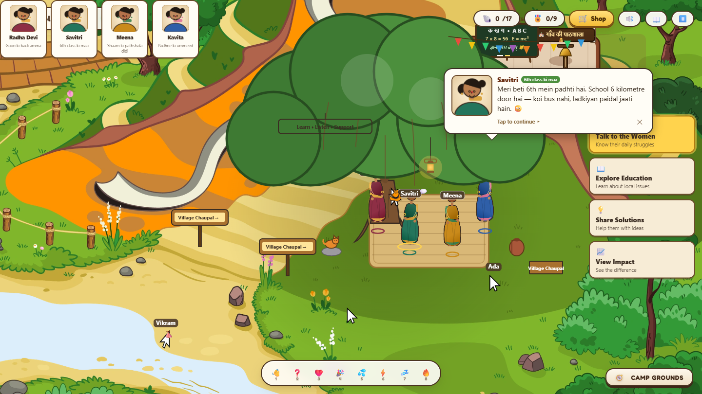 |

| Who | Age | Her angle |
|---|---|---|
| **Radha Devi** | 52 | Household work eats the study hours; homework by lamp light |
| **Savitri** | 28 | School is 6 km away, no transport — and no girls' toilet, so 4–5 days are lost every month |
| **Meena** | 24 | Married at 17, dropped out in class 10, now runs an evening *pathshala* |
| **Kavita** | 19 | Online classes on a shared phone, no data pack, no library — wants to be a teacher |

### Three panels behind the talk

| Explore Education | View Impact |
|---|---|
| 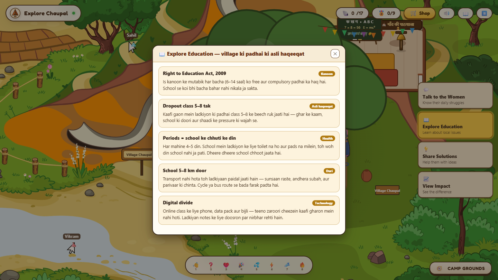 | 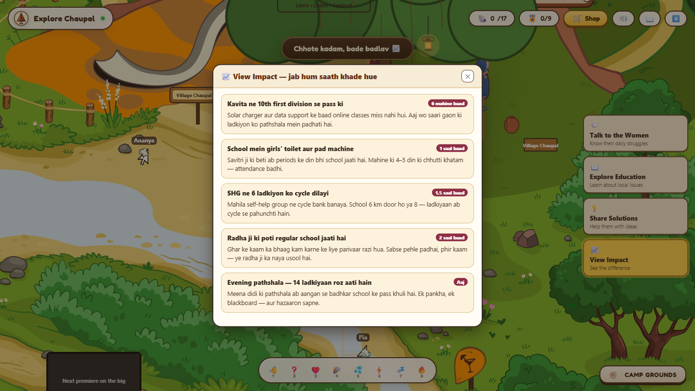 |

Five issue cards (RTE Act, dropout years, periods as lost days, distance, the digital divide), five things that actually work, and a timeline of small wins. Click the tree, not just the menu — the mat works too.

### The Village Pathshala

| Schoolyard | Classroom |
|---|---|
| 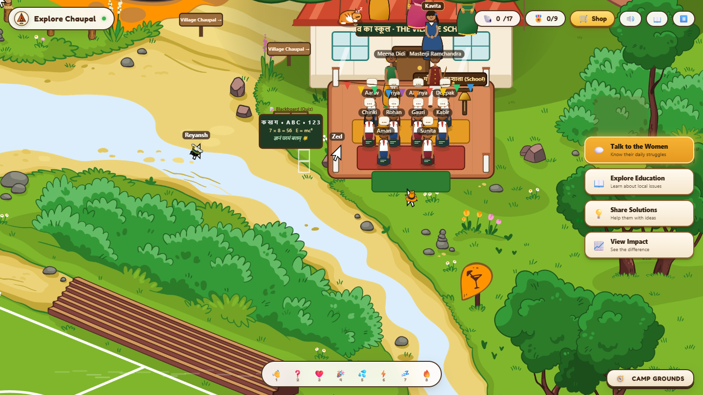 | 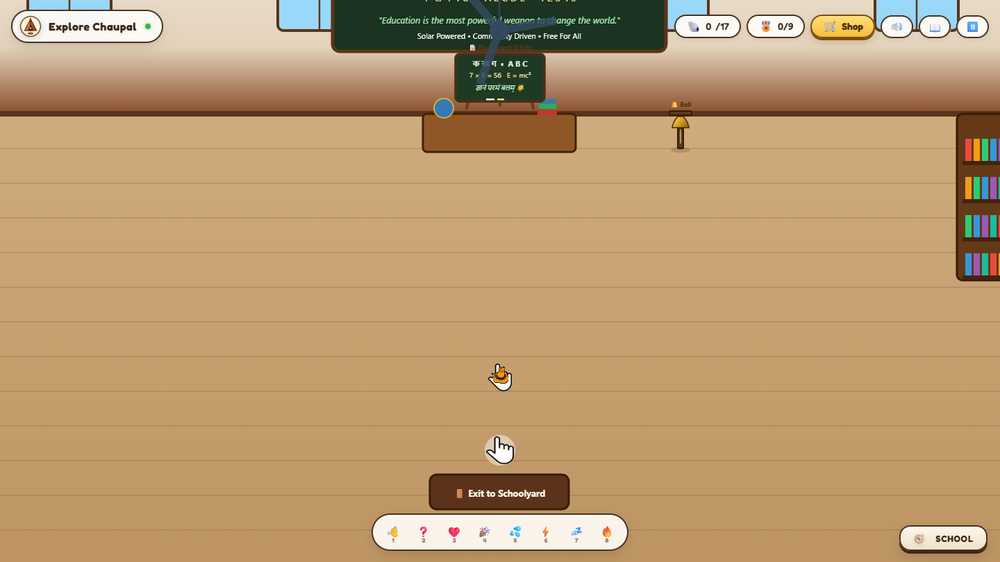 |

Meena Didi teaches six kids — Aarav, Priya, Chinki, Aman, Gauri and friends. Blackboard, bell, bookshelf, exit mat. The gate works by *walking* or by *clicking the door* — both.

### Rooms with their own weather

| Treehouse | Sauna |
|---|---|
| 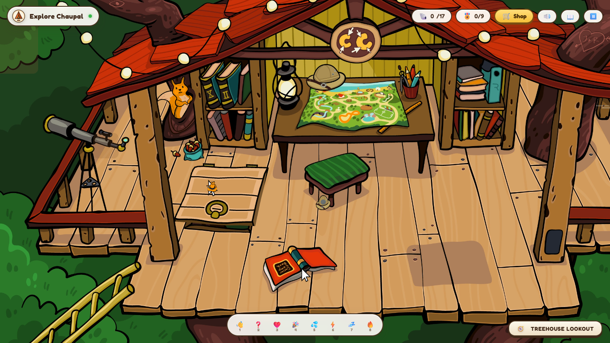 | 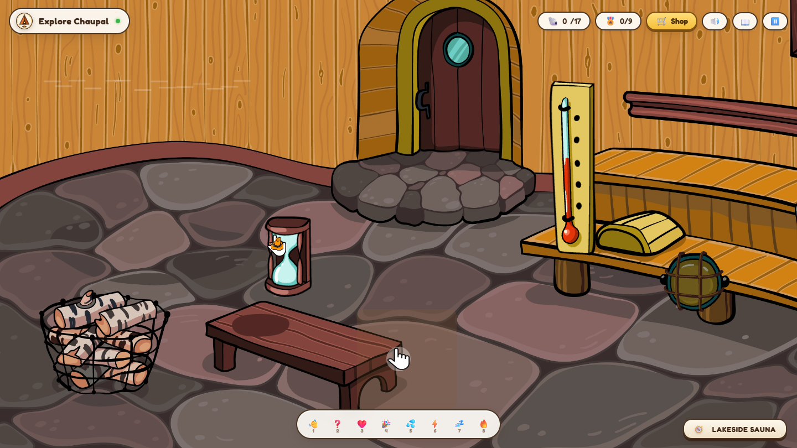 |

Twelve maps: campground, sauna, tent, cave, treehouse, four rooms of the house, boat, telescope, school. Eighteen interior doors. Try the trapdoor.

### Shells, shop, badges

| Camp Trading Post | Badges |
|---|---|
| 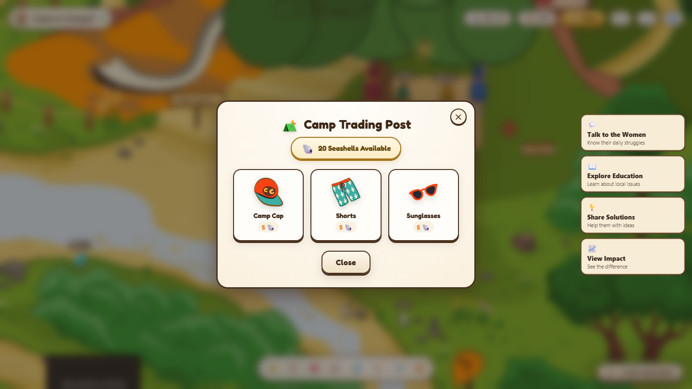 | 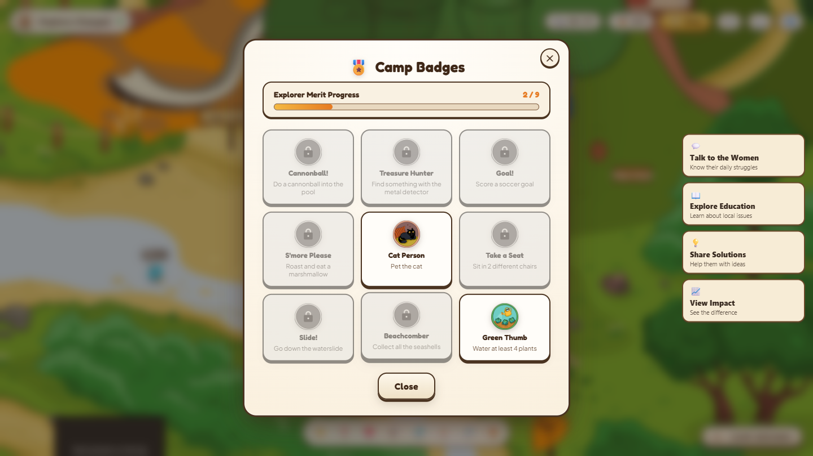 |

17 seashells, three hats, nine badges. Five shells buys the Camp Cap; the rest is between you and the sand.

---

## Things that actually *do* something

### 🎬 The cinema plays films

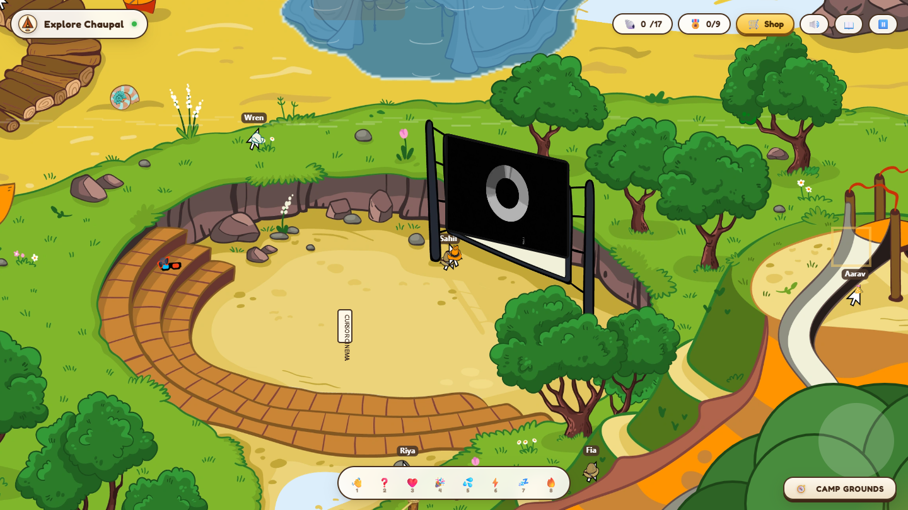

Six features on a skewed board, streamed locally with HTTP Range, volume fading as you walk away. Get close and it's already running. **Click the screen for sound.**

### 🌊 Water you can swim

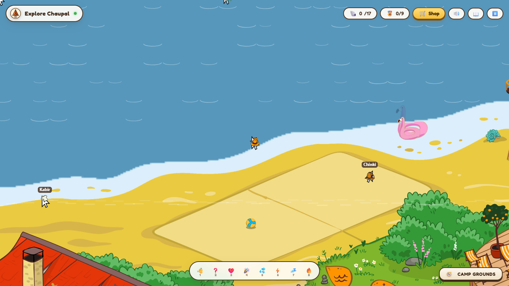

The shoreline is a real mask: ocean, river and shallows, foam where they meet land, animated shimmer, and slower movement once you're in it. The pink flamingo is not a bug.

### 🔥 Fire you can roast on

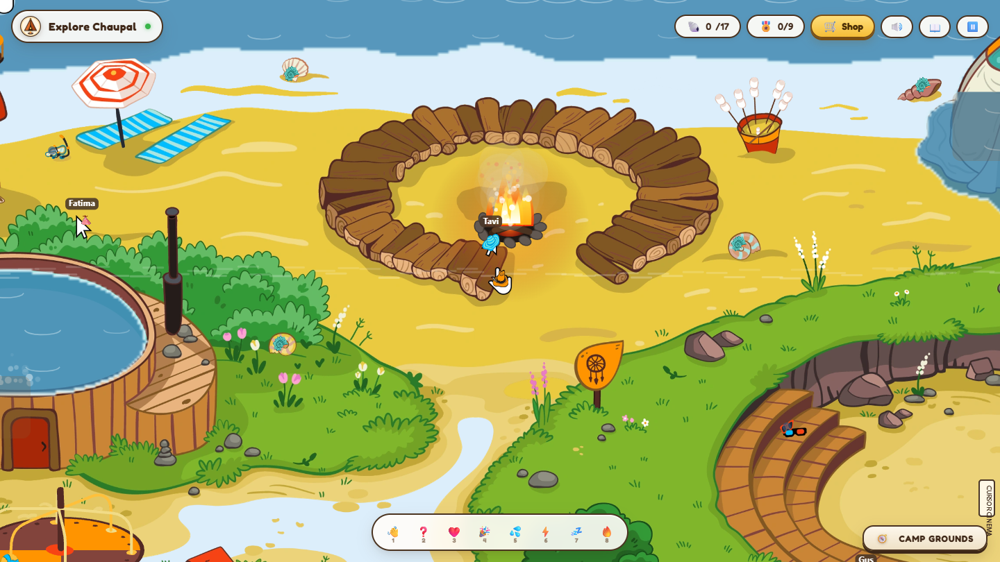

Flames, embers, smoke. Grab the marshmallow stick, stand close, watch it brown, then eat it for shells.

### 🚪 Doors answer clicks

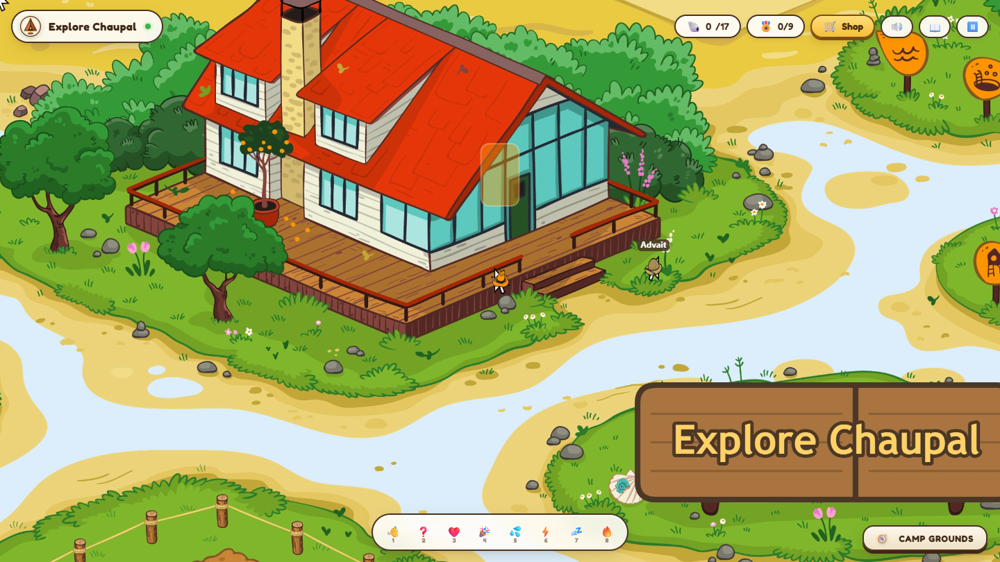

Click the painted door (or walk into it) and you're inside. No hunting for an invisible hitbox on a bush. Same for all 26 doors in the game.

---

## What's in the box

| | |
|---|---|
| **Maps** | 12 — campground (6,750 × 3,797 px) + 11 interiors |
| **Doors** | 26 (8 on the campground, 18 inside) |
| **Art** | 177 map/tile files, 21 Rive `.riv` animations, 145 optimized sprites & sounds |
| **Audio** | 57 mp3s through howler.js — one-shots, spatial loops, 8-track concert |
| **Toys** | soccer, volleyball, tetherball, seesaw, merry-go-round, waterslide, cannonball, piano, drums, gong, bell, metal detector, campfire, plant watering |
| **People** | 45–50 wandering campers with names and hats |
| **Village** | 4 women · 4 dialogue trees · 3 panels · 1 school · 6 students · 1 cat |
| **Film library** | 6 features, ~1.3 GB, served locally |
| **Build steps** | 0 |

---

## How the magic trick works

### Two canvases and a lot of depth sorting

Everything is drawn into a `world` canvas and an `overlay` on top. Each frame: map tiles → water → every entity sorted by **feet Y** → the **top layer** (canopies, roofs) → cinema picture → cursor.

The top layer is the whole trick: it's what makes "walk behind a tree" work, and it's why the cinema board used to swallow its own movie until the picture moved above it.

### Tiles are lazy

The campground is a 14 × 8 grid of 512 px tiles at 1.6×. Only what the viewport needs is fetched (plus a two-tile margin), cached by `layer_col_row`, and skipped for a frame if it hasn't arrived. A 6,750 px world boots from a handful of requests instead of 175.

### The coordinate flip that ate a day

The reference data measures Y from the **bottom** of the map; the renderer is top-down. `U.flipMap()` converts on load — including door destinations, which have to be flipped against the *destination* map's height. Get that wrong and every door deposits you on the far wall. (We got it wrong. It's written down now.)

### Procedures where it counts

The village, the women, the classroom, the signs, the water shimmer and the fire are all canvas gradients and paths (`village-art.js`, `village.js`, `village-school.js`, `tiledmap.js`, `procfx.js`). New content in the original visual language, zero new bitmaps.

### File map

```
standalone/
├─ index.html            DOM shell: HUD, modals, emote dock, canvases
├─ css/style.css         the whole look
├─ js/
│  ├─ game.js            loop, camera, doors, picking, rendering, cinema
│  ├─ player.js          movement, trail, hats/shorts/glasses
│  ├─ objects.js         ~54 element types: chairs, rivers, soccer, shells…
│  ├─ tiledmap.js        lazy tiles + water mask, tint and shimmer
│  ├─ campers.js         wandering NPCs
│  ├─ dialogue.js        Village Chaupal script (Hinglish)
│  ├─ village-art.js     women sprites, portraits, wayfinding signs
│  ├─ village.js         banyan tree, mat, cat, zone logic
│  ├─ village-ui.js      bubble, chooser, panels
│  ├─ village-school.js  schoolyard + classroom
│  ├─ economy.js         shells, shop, badges, saves
│  ├─ audio.js           howler glue + spatial falloff
│  └─ procfx.js          fire, steam, sound waves
├─ data/                 map JSON, config, embedded fallback, schedule
├─ assets/               tiles, rooms, .riv, sounds, badges, shop
└─ vendor/               rive.js, howler.min.js
```

---

## Proof it works

The repo keeps its Playwright harness — no "looks fine on my machine".

| Script | What it checks |
|---|---|
| `probe.js` | Boots with zero page errors and zero missing assets |
| `e2e.js` | Enter → walk → door transition → shop |
| `doorcheck.js` | All 8 campground doors open on click, arrivals land on the doorway, walk-over still works |
| `mechaniccheck.js` | 18 interior doors, toys, campfire, watering, gadgets, triggers |
| `villagecheck.js` | Chooser, four stories, three panels, map round-trip |
| `bugcheck.js` | Phantom clicks gone; doors answer near and refuse far |
| `opencheck.js` | Telescope exit and treehouse trapdoor clickable |
| `artcheck.js` | Sprites, portraits, signs render |
| `school-test.js` | School gate, teacher, students, campers |

```powershell
node serve.js          # one terminal
node probe.js          # another
node doorcheck.js
```

Latest run: `probe` 0 errors / 0 missing · `doorcheck` 17/17 · `mechaniccheck` 25/25.

The ugly details — bundle structure, socket protocol, element inventory, every deviation — live in [re/REPORT.md](re/REPORT.md).

---

## Known limits

- **Single player.** The world is one save file and a lot of NPCs; there is no multiplayer server.
- **Saves are local.** `localStorage`, key `cc-standalone-save-v1`.
- **The film library is large.** ~1.3 GB of mp4 lives in `capture2/movies/`; `serve.js` streams it, so don't ship that folder to a static host without trimming it.
- **A few originals are absent upstream too** — a beret hat, a volleyball-net sound, a sauna loop, one horse sprite. They degrade quietly instead of exploding.

---

## Credits

Campground art, audio and the original layout come from a third-party illustrated build captured for study; they are retained here for personal, non-commercial use and are **not** cleared for redistribution. Village Chaupal, the Pathshala, their characters, dialogue, panels and UI are original to this project.

<sub>**0 build steps · 12 maps · 26 doors · 6 films · 4 women under one tree.**</sub>
# Chaupal

